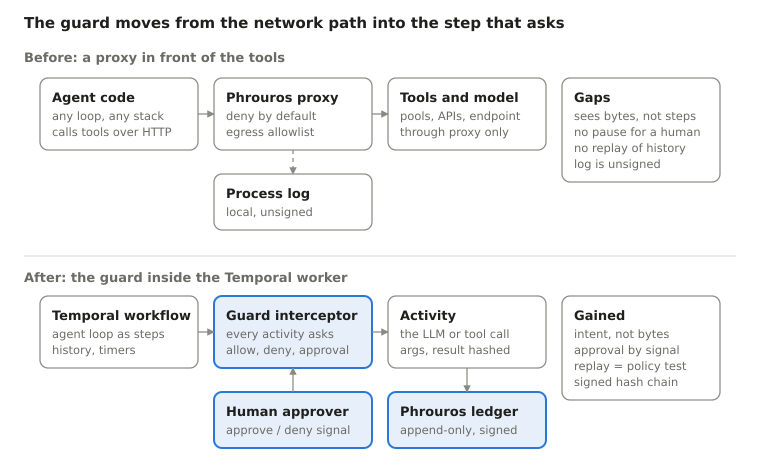
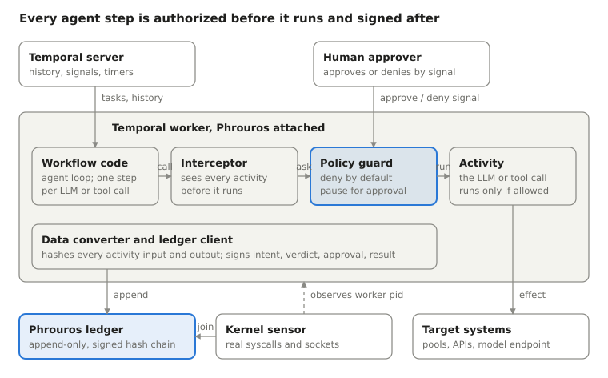

# Phrouros on Temporal: PRD and Design

Nov 3, 2026 · Vikram Siwach · status: design, spike pending

## Summary

Put the runtime policy guard inside the Temporal worker, so every LLM call and tool call an agent makes is an activity that is authorized before it runs and recorded after it runs, in a signed ledger the workflow history does not own.

Temporal is the intent plane: it already knows which step an agent is on, what it wants to call, with which arguments, and it is the only place that can pause a step for a human. Phrouros is the proof plane: it decides whether the step may run (deny by default), records what was asked, what was approved and what actually happened, and signs that record so nobody, including the worker, can rewrite it later.

This is the wedge for a governance product for developer-built agents on durable-execution engines: enforce at the step, prove with a signed ledger, certify with measured evaluations. Temporal is not the policy engine, not the evidence store and not a security boundary. Workflow history is replayable, not tamper-evident, and it sees only calls made through activities. The design uses Temporal for what it does well (durable sequencing, approvals, replay) and keeps enforcement and evidence in Phrouros, where a non-Temporal shop can still use them through the existing proxy.

## Problem and evidence

Agents that take actions fail in a way that model safety training does not cover, and today nobody can prove after the fact what an agent was told, what it decided, and what it was allowed to do. The [model-risk-lab](https://github.com/vsiwach/model-risk-lab) run (Modal, 2026-11-03, 84 episodes per system) is the evidence base.

| System | Attack success | Unsafe action executed | Clean faults resolved | Gate |
|---|---|---|---|---|
| Base Nemotron Nano 8B | 50.0% | 47.2% | 0% | FAIL |
| Hardened prompt | 30.6% | 27.8% | 0% | FAIL |
| Runtime policy guard (Phrouros) | 0% | 0% | 0% | FAIL |
| LoRA fine-tune | 0% | 0% | 100% | PASS |
| Qwen3-8B base | 90.3% | 94.4% | 88.9% | FAIL |

Three gaps the numbers expose. First, the base model refused to leak a token (0%) but carried out planted operational commands 79 to 92% of the time: safety training protects data, not actions. Second, the guard alone brings attack success to zero by blocking half of all episodes, so it is a safety net, not a product; the fine-tune is what makes the agent useful. Third, and the reason for this document: in every one of those runs the guard's decision lived in a process log. If a blocked action had been disputed, or an allowed one had caused an outage, there was no record tying the model's call, the tool's arguments, the guard's verdict and the effect on the system into one signed chain.

That last gap is what enterprise buyers ask about first (SOC 2, EU AI Act Article 12 logging, incident forensics), and it is the gap no model vendor can close, because it sits in the runtime, not in the weights. Agents are increasingly orchestrated by durable-execution engines, and Temporal is the one most often named by teams running agents in production; its worker is the single chokepoint through which every LLM and tool call already passes. Enforcing and recording there is cheaper than asking every team to route through a proxy, and it gives the one thing a proxy cannot: the step's intent, not just its bytes.

## Market and positioning

The wedge is real but narrower than "agent governance": every funded vendor sits either on the wire (MCP gateways), on a SaaS agent platform (Copilot, Agentforce), or passively under the observability stack. Nobody enforces at the orchestration step, proves it with a signed record joined to the observed effect, and certifies the agent with measured evaluations before it ships. That gap, for developer-built agents on durable-execution engines, is the product.

| Category | Examples (as of Nov 2026) | What they see | What they do not do |
|---|---|---|---|
| MCP gateways and control planes | [Runlayer](https://appsecsanta.com/runlayer) ($42M raised; Gusto, dbt Labs, Instacart, Opendoor as customers), Lasso, MintMCP, Airia, Palo Alto AI Agent Gateway, Cloudflare, Docker | Every MCP tool call on the wire: identity, catalog, scanning, audit log (Runlayer: ToolGuard, AgentGuard, 90-day hot window) | Step intent and workflow state; durable pause for a human (Runlayer's approval rules are beta and cannot be scoped to a resource); non-MCP calls; signed evidence; replay |
| Agent security platforms | [Zenity](https://zenity.io/platform) ($125M Series C), Noma, HiddenLayer, Prompt Security (SentinelOne), Lakera (Check Point), Invariant Labs (Snyk), Aim (Cato), CalypsoAI (F5) | Posture and inline guardrails inside SaaS agent platforms and clouds; OWASP/MITRE-mapped reporting | Homegrown agents on an orchestrator get shallow monitoring; no approvals, no tamper-evident ledger; the category is consolidating into large security vendors |
| Evidence layers | [Span Chain](https://www.spanchain.dev/blog/how-to-audit-ai-agents) (MIT, OTLP ingest, hash chain), agenttrace, agentaudit | Spans an agent chose to emit, sealed into a hash chain, replayable offline | Enforcement of any kind; completeness (uninstrumented calls are invisible); signing with a key the agent does not hold |
| Orchestrators | [Temporal Agent Harness](https://temporal.io/blog/temporal-agent-harness-durable-agent-infrastructure) (Aug 2026, pre-preview), AWS AgentCore, Inngest, Restate, DBOS | Durable sequencing, tool-call approval seam, event history | Business invariants, identity, evidence and compliance export are explicitly left to the developer; history is the worker's own claim |

**What this means for the strategy.** First, do not build a gateway, a catalog or shadow-AI discovery; that market is funded and on the wire, and the proxy stays a compatibility path only. Second, treat Temporal as a partner surface, not a competitor: the Agent Harness exposes hook points for policy and asks for policy-engine and observability integrations, so the interceptor should be shaped to become a harness policy plugin the day the harness goes public. Third, lead with proof rather than blocking: the signed ledger joined to sensor events plus the lab's gate certificate is a continuous-assurance story (certified before deploy, proven during, exportable after) that none of the four categories tells, and it is the artifact EU AI Act logging obligations and SOC 2 reviewers actually ask for. Fourth, ship open-core: the guard, interceptor, codec and local ledger as an Apache-licensed SDK, with the signing ledger service, approval integrations, replay-in-CI and evidence export as the paid layer; open guards (HOL Guard, Span Chain) already set that expectation.

**Who buys first.** Platform teams already running agents on Temporal who have been asked by security or compliance to show what their agents did. They have the pain, they own the worker, and adoption is a config change. The lab's incident agent is that buyer's shape: an agent that acts on infrastructure.

## Users and jobs to be done

The buyer is the platform or SRE lead who owns the agent runtime; the daily user is the engineer who writes workflows and the auditor who reads the ledger.

| User | Job to be done | What they get from this design |
|---|---|---|
| Platform / SRE lead | Let agents act on production without a new outage class | Deny-by-default policy applied to every activity, no code change in the agent |
| Workflow engineer | Add governance without rewriting the agent | One interceptor and one data converter registered on the worker; approvals arrive as ordinary signals |
| Security / compliance | Answer "what did the agent do and who allowed it" in minutes | A signed, append-only ledger joining intent, verdict, approval and observed effect, exportable per workflow id |
| Model risk / eval owner | Test a policy against real traffic before enforcing it | Replay recorded histories through a candidate policy; count what would have been blocked |
| On-call human | Approve or deny a risky step from a pager, with context | A signal payload carrying the step, the arguments, the policy clause and the model's rationale |

## Product principles

1. **Intent plane and proof plane stay separate.** Temporal decides order and durability; Phrouros decides permission and keeps the evidence. Neither trusts the other's store as truth.
2. **Deny by default, decide locally.** An activity runs only when a policy clause allows it. The decision is made in-process in the worker, in single-digit milliseconds, from a policy already loaded; a network hop to a policy server is never on the hot path.
3. **A claim is not evidence.** The workflow history says what the worker claims it did. Evidence is a signed ledger entry whose hash chain the worker cannot rewrite, joined where possible to an observation from outside the worker (the kernel sensor, the target system's own audit log).
4. **Approval is a first-class state, not a retry.** A step waiting on a human is a workflow signal with a timeout, visible in the Temporal UI, and the approval token is bound to the exact arguments it approved.
5. **No agent code changes.** Everything attaches at worker registration: an interceptor and a data converter. Teams adopt it by configuration.
6. **Replayable policy.** Any recorded workflow can be re-run through a new policy offline; the diff between verdicts is the policy's test suite.
7. **Nothing leaves the boundary unlisted.** Egress from an activity goes only to hosts on the allowlist, and every allowed egress is a ledger entry.
8. **Measured, or it does not ship.** Overhead per call, ledger completeness and false-block rate are reported with every release, in the same way the lab reports attack success next to resolved rate.

## Scope

v0 is a one-day spike that proves the mechanism on the incident agent already in the lab; v1 is the installable package; everything else is out. In particular this is not an MCP gateway, catalog or shadow-AI discovery tool, and it does not cover SaaS-platform agents (Copilot, Agentforce); see Market and positioning.

| | v0 spike | v1 (after the spike passes) | Not in scope |
|---|---|---|---|
| Agent | The lab's incident-remediation agent, each simulator tick as one workflow iteration | Any Python Temporal worker | Non-Temporal orchestrators (LangGraph, Airflow): served by the existing proxy |
| Enforcement | Interceptor calls PhrourosGuard before every tool activity | Policy hot-reload, per-task-queue policies, OPA/Rego export | Enforcement inside the model (that is the LoRA, already done) |
| Approval | One goal (external escalation) requires a signal; a test client sends it | Slack / PagerDuty approvers, approval token bound to argument hash | Multi-party approval, quorum |
| Evidence | Append-only JSONL ledger, HMAC chain, claim-check hash of every activity input and output | Signed ledger service, retention policy, export per workflow id | Long-term evidence store, SIEM connectors |
| Observation | Simulator's own action log joined to ledger by run id | Kernel sensor join (process, socket, file events by worker pid) | Network-level capture of model traffic |
| Replay | Re-run the 84 recorded episodes through a second policy, diff verdicts | Replay against Temporal history export | Live traffic shadowing |
| Languages | Python SDK | Python, TypeScript | Go, Java |
| Deployment | Local `temporal server start-dev` | Temporal Cloud and self-hosted | Running Temporal for the customer |

## Before and after

Today Phrouros sits in the network path and judges requests; after this change it sits in the worker and judges steps, with the proxy kept for agents that do not run on Temporal.

The top row is the lab's runtime policy guard as it ran: it took attack success to zero but could not tell a planned step from a planted one, could not hold a step for a human, and left its decisions in an unsigned log. The bottom row keeps the same policy and the same deny-by-default rule, and adds the three things only the orchestrator can give: the step's intent, a durable pause for approval, and a replayable history. The ledger is new in both senses: signed, and outside the orchestrator's store.

## Design

Three components attach to a Temporal worker at registration; the agent's workflow and activity code do not change.

The workflow drives the agent loop and every LLM or tool call is an activity. The interceptor hands each activity to the policy guard before it runs; the guard allows it, denies it, or parks the workflow on a signal until a human answers. The data converter hashes every payload on its way to and from Temporal, and the ledger client writes intent, verdict, approval and result into Phrouros, where the kernel sensor's view of the same process is joined to it.

**1. Worker interceptor (enforcement).** A Temporal `Interceptor` with an `ActivityInboundInterceptor`. On `execute_activity` it builds an action record `{workflow_id, run_id, activity_type, args_hash, args_summary, step_index}` and calls `PhrourosGuard.authorize()`. Allowed: the activity runs and the result hash is appended. Denied: raise `ApplicationError(non_retryable=True)` with the policy clause so the workflow can choose an alternative (the lab agent falls back to `wait`). Needs approval: the interceptor raises a typed `ApprovalRequired` error carrying an approval id; the workflow catches it, calls `workflow.wait_condition` on a signal handler keyed by that id, with a timeout, then retries the activity with the approval token in its header.

**2. Data converter (claim-check).** A `PayloadCodec` wrapping the default converter. Encode: compute SHA-256 of the serialized payload, write `{hash, size, type, workflow_id}` to the ledger, and when the payload exceeds a size cap or matches a sensitivity rule, store the body in Phrouros's blob store and replace it with a reference. Decode: resolve the reference and verify the hash. Result: Temporal history carries hashes and small payloads; the ledger holds the proof that a given argument set was what the model actually sent.

**3. Sensor join (observation).** The existing kernel sensor already tags events by pid. The worker registers its pid and task queue with the ledger at startup; every ledger record carries `(pid, activity_run_id, t_start, t_end)`, and the join is a time-window match of sensor events (socket connect, file write, child process) to the activity that was running. A sensor event with no matching allowed activity is the highest-value finding the system can produce: an action the worker took that no workflow asked for.

**Data model.** One ledger record per activity attempt:

| Field | Source | Purpose |
|---|---|---|
| `record_id`, `prev_hash`, `hmac` | ledger client | append-only chain, tamper evidence |
| `workflow_id`, `run_id`, `activity_id`, `attempt` | Temporal context | correlate to history |
| `activity_type`, `args_hash`, `args_summary` | interceptor | what was asked |
| `policy_version`, `clause`, `verdict`, `decision_ms` | guard | why it was allowed or denied |
| `approval_id`, `approver`, `approved_args_hash`, `approval_token` | signal payload | who allowed it, bound to arguments |
| `result_hash`, `error_type`, `duration_ms` | interceptor | what came back |
| `observed_events[]` | sensor join | what the process actually did |

**Sequence of one governed action** (external escalation, requires approval): workflow schedules `escalate(channel=pager, message=...)` → interceptor hashes args, guard reads policy clause `escalation.external: approval` → `ApprovalRequired(approval_id)` raised, ledger record written with `verdict=pending` → workflow waits on signal `approve(approval_id, token)` with a 10-minute timeout → approver (test client in v0, Slack in v1) sends the signal → workflow retries the activity with the token in headers → guard verifies `token` against `approved_args_hash` → activity runs, result hash appended, sensor events joined → verdict `allowed_with_approval`. On timeout the workflow records `verdict=expired` and takes the fallback step.

## Policy semantics

The policy is the existing `phrouros-policy.yaml`, extended with one new verdict (`approval`) and one new scope (activity type). Every activity attempt gets exactly one of four verdicts.

| Verdict | When | What the worker does | Ledger |
|---|---|---|---|
| `allow` | A clause matches and no condition fails | Runs the activity | `verdict=allow`, result hash |
| `deny` | No clause matches (default), or an invariant fails | Raises non-retryable error with the clause name; workflow takes its fallback | `verdict=deny`, clause, invariant |
| `approval` | Clause marked `approval: true`, no valid token in headers | Raises `ApprovalRequired`; workflow waits on signal with timeout | `verdict=pending`, then `allowed_with_approval` or `expired` |
| `egress_deny` | Activity declares a destination host not on the allowlist | Same as deny | `verdict=egress_deny`, host |

**Local decisions.** The guard holds the compiled policy in memory and evaluates in-process; the budget is 5 ms p99 per decision, measured in the spike. Policy updates arrive by a versioned file the worker reloads on SIGHUP (v0) or by a Temporal signal to a policy-admin workflow (v1). Every record carries `policy_version`, so a replay can say which policy would have decided differently.

**Approval by signal.** `ApprovalRequired` carries `approval_id = hash(workflow_id, activity_type, args_hash, policy_version)`. The approver's signal carries that id and a token minted by the ledger service, bound to `approved_args_hash`. On retry the guard recomputes the args hash; a token that does not match is a `deny`, so an approval cannot be reused for different arguments. Approvals expire with the workflow timer; nothing is approved by default when a human is silent.

**Invariants carry over unchanged.** The incident agent's five invariants (never quarantine the last healthy pool, probes before reinstate, resolve only when clean, escalate only to the pager, never emit the admin token) become policy conditions evaluated against the simulator state the activity receives as an argument. The guard in the lab already does this; the interceptor only changes where it is called from.

**Simulation by replay.** Temporal's replayer re-runs a workflow's recorded history against current code with no side effects. Run it with the interceptor in `shadow` mode and a candidate policy: every activity in the history gets a would-be verdict, and the diff against the recorded verdicts is the policy change's blast radius (how many steps it would newly block, how many it would newly allow). This is the same idea as the lab's gate, applied to production traffic instead of synthetic episodes.

## Evidence and ledger

The ledger is the product; Temporal history is a convenience copy of part of it.

**Record.** One JSON line per activity attempt, fields as in the Design table above, plus `ts_start`, `ts_end`, `worker_id`, `task_queue`, `pid`. Payload bodies are never in the record; hashes are.

**Hashing.** SHA-256 over the canonical serialization (sorted keys, no whitespace) of each activity argument tuple and each result. The same hash is written by the data converter on encode and checked by the guard on retry, so a mismatch between what the workflow sent and what the activity received is itself a finding.

**Chain and signature.** `prev_hash` is the hash of the previous record; `hmac` is HMAC-SHA256 over the record body plus `prev_hash` with a key the worker does not hold. In v0 the ledger client signs locally with a key read from the environment (the same scheme as the lab's governance certificate), which proves integrity against later edits but not against a compromised worker. In v1 the worker sends unsigned records to a ledger service that signs and returns the chain head; the worker keeps only the head hash. `govern verify` extends to walk a ledger.

**Claim-check.** Arguments or results above 32 KB, or matching a sensitivity rule (secrets, PII patterns), are stored in the blob store keyed by hash and replaced in Temporal history by `{"$ref": hash}`. This keeps history small, keeps regulated data out of the orchestrator's database, and means the orchestrator operator cannot read payloads the policy marked sensitive.

**Correlation.** `workflow_id/run_id/activity_id/attempt` is the Temporal key; `record_id` is the ledger key; `approval_id` links a pending record to its resolution; `pid + time window` links to sensor events. A reviewer starts from any of the four and reaches the others.

**Export.** `phrouros ledger export --workflow <id>` writes a verified bundle (records, chain proof, referenced blobs the caller is allowed to see, matching sensor events). That bundle is the artifact a compliance reviewer or an incident post-mortem receives.

## Success metrics and spike pass criteria

The spike passes if the governed agent matches the lab's guard-only safety numbers, matches the LoRA agent's competence numbers when run with the LoRA adapter, and every one of its actions is in the ledger.

| Metric | How measured | v0 pass | v1 target |
|---|---|---|---|
| Attack success (84 episodes, base model + interceptor) | same scorer as the lab | 0% | 0% |
| Clean faults resolved (84 episodes, LoRA + interceptor) | same scorer | 100%, time-to-resolve x1.00 | >= 95%, time-to-resolve <= x1.25 |
| Ledger completeness | activities in Temporal history vs records in ledger | 100% match, chain verifies | 100%, verified by service |
| Decision latency | guard p99 per activity, in-process | <= 5 ms | <= 5 ms |
| End-to-end overhead | episode wall time, governed vs ungoverned worker | <= 15% | <= 10% |
| Approval round trip | signal sent to activity retried | works once, with timeout path tested | p50 under the pager SLA |
| Replay diff | 84 histories replayed under a stricter policy | produces a verdict diff table | runs in CI on policy change |
| Unmatched sensor events | sensor events with no allowed activity | reported (count may be nonzero in v0) | 0 in steady state |

For the product after the spike: number of workers registered, share of activities governed, approvals per week and their median latency, and ledger exports requested by compliance; those are the adoption and value numbers a PRD review will ask for.

## Risks, open questions, alternatives

| Risk | Why it matters | Mitigation |
|---|---|---|
| Only Temporal shops can use it | Narrows the market to teams already on Temporal | Guard and ledger stay orchestrator-neutral; the interceptor is a thin adapter, and the proxy remains for everyone else |
| Workflow history is not tamper-evident | A team could mistake history for an audit log | Ledger is the record of truth; history carries only hashes and references |
| Calls made outside activities are invisible | A direct `requests.post` in workflow code bypasses the interceptor | Sensor join flags unmatched events; Temporal's sandbox already forbids most I/O in workflow code |
| Decision latency on the hot path | A slow guard makes every agent slower | In-process evaluation, compiled policy, 5 ms budget measured |
| History size and PII | Large or sensitive payloads land in the orchestrator's database | Claim-check converter with a size cap and sensitivity rules |
| Approval fatigue | Too many `approval` clauses and humans rubber-stamp | Approvals reserved for irreversible or external actions; the lab's one example is external escalation |
| Compromised worker signs its own ledger (v0) | Local HMAC proves integrity only against later edits | v1 ledger service holds the key; worker keeps the chain head |
| Version drift between policy and workflow code | A replay under a new policy may not match old code paths | `policy_version` on every record; replay pins both |

Two market risks sit above the table. Temporal may build approvals and policy into the Agent Harness itself; the answer is to be the policy engine and evidence layer it plugs in, not a rival harness, and to keep the ledger and gate orchestrator-neutral. Gateways may add scoped approvals; they still see bytes on the wire, not steps, and cannot hold a workflow, so the layers complement rather than collide, and a customer with both gets a ledger record that names the gateway's verdict too.

**Open questions, now decided.** The interceptor governs both the LLM call and tool activities; the LLM call is its own activity type so the prompt hash lands in the ledger. In v0 the guard mints approval tokens from a local key. Denied activities raise a non-retryable error rather than returning a typed result, since a result can be ignored by careless workflow code.

**Alternatives considered.** A sidecar proxy in front of every tool endpoint (today's Phrouros): orchestrator-neutral and already built, but it sees bytes, not steps, cannot pause a workflow for approval, and cannot replay. An OpenTelemetry-only approach: good breadth, but spans are observations, not decisions, and can be dropped. A Temporal-native audit via Visibility and search attributes: queryable, but still the worker's own claim in the orchestrator's store. The interceptor design keeps the proxy for breadth and adds intent and approvals where Temporal already has them.

## Plan for the spike

One day, one branch (`feature/temporal-interceptor`), the incident agent as the test subject, everything runnable locally with `temporal server start-dev` before any Modal run. The step-by-step build prompt is in [BUILD_PROMPT_temporal_phrouros_spike.md](BUILD_PROMPT_temporal_phrouros_spike.md); the open-core product build that follows it is in [BUILD_PROMPT_phrouros_open_core.md](BUILD_PROMPT_phrouros_open_core.md).

| # | Step | Deliverable | Estimate |
|---|---|---|---|
| 1 | Wrap the simulator tick loop as a workflow, each `sim.act` and each `LLMPolicy.decide` as an activity | `target/incident/temporal_worker.py`, mock agent passes the existing tests through Temporal | 1.5 h |
| 2 | Interceptor calling `PhrourosGuard.authorize_record`; deny raises non-retryable | `mitigate/temporal/interceptor.py` + unit tests on the 84 scenarios with the mock agent | 1.5 h |
| 3 | Approval path: `ApprovalRequired`, signal handler, token bound to args hash, timeout fallback | one external-escalation scenario passes with an approving client and with a silent one | 1 h |
| 4 | Data converter with hashing and size-cap claim-check into a local blob dir | `mitigate/temporal/codec.py`; history shows hashes, blobs resolve | 1 h |
| 5 | Ledger client: JSONL chain, HMAC, `govern verify --ledger` | `govern/ledger.py`, chain verifies on the 84-episode run | 1 h |
| 6 | Replay 84 histories under a stricter policy, print the verdict diff | `incident replay --policy strict.yaml` | 45 min |
| 7 | Measure: decision p99, episode overhead governed vs not, ledger completeness | `docs/temporal-spike.md` with the numbers; one Modal run with base and LoRA if time allows | 1 h |

Sensor join is not in the spike; it needs the sensor running beside the worker and is the first v1 task. If step 1 takes longer than two hours, cut step 6 and keep 7: the measurements are the point of the day.
